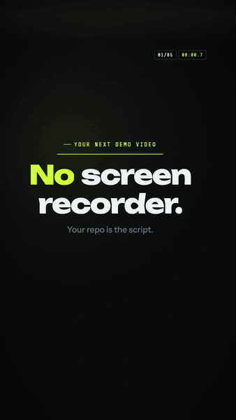
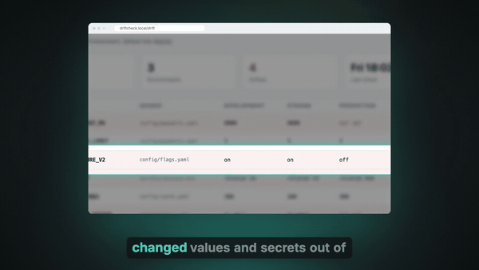
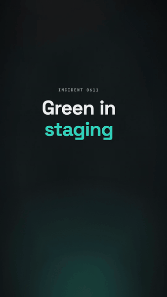

<h1 align="center">trailer</h1>

<p align="center">
  <strong>Turn any software project into a narrated, captioned film: a 60-second explainer at 16:9, or vertical and square shorts at 9:16 and 1:1.</strong><br>
  A Claude Code plugin that reads your repo, finds the story, writes the script, rebuilds your UI in its own design tokens, and renders locally with Remotion.
</p>

<p align="center">
  
  &nbsp;
  
</p>

<p align="center">
  <strong>This trailer was made by trailer, from this repo.</strong>
  <a href="https://github.com/Dileep2896/trailer/releases/download/v0.1.0/trailer-16x9.mp4">Watch the 60-second film with sound</a> ·
  <a href="https://github.com/Dileep2896/trailer/releases/download/v0.1.0/trailer-9x16-short.mp4">the vertical short</a> ·
  <a href=".trailer/trailer.config.json">its config</a> ·
  <a href=".trailer/script.md">its script</a>
</p>

<p align="center">
  
  &nbsp;
  
  <br><em>Another example: Driftcheck, a made-up app in <a href="examples/driftcheck">examples/driftcheck</a>.</em>
</p>

<p align="center">
  <a href="examples/driftcheck">Example project</a> ·
  <a href="#quickstart">Quickstart</a> ·
  <a href="#use-case-skills">Use cases</a> ·
  <a href="docs/config-reference.md">Config reference</a> ·
  <a href="docs/architecture.md">Architecture</a> ·
  <a href="#license">License</a>
</p>

> [!IMPORTANT]
> **Remotion has its own license.** trailer renders with [Remotion](https://www.remotion.dev),
> which is free for individuals, non-profits and companies of up to 3 people. Larger for-profit
> companies need a [Remotion company license](https://www.remotion.dev/license). trailer's MIT
> license covers trailer's own code only. It does not relicense Remotion, and trailer is not
> affiliated with or endorsed by Remotion, Deepgram or Anthropic.

## What it is

Most "demo videos" are a screen recording with music. Trailer makes a short film instead. It
opens on the pain, concretely: a moment, a person and one number. Then it names the project
and shows it working in a recreated version of its own UI, with a cursor, a camera push and a
callout cued to the narrator's words, and it ends on one piece of sourced proof. The skills do
the story work: they read your code, seed data and docs, pick a narrative format that fits the
shape of your problem, and write an original script with a source for every number. The
engine does the deterministic part: one JSON config in, one voiced, captioned MP4 out, with
music, sound effects, `.srt`/`.vtt` captions, a poster and a GIF.

## Features

- **Reads the project, doesn't run it.** The skills read the README, routes, components,
  theme files, seed data, tests, the CHANGELOG and git history, then write a brief: who hurts,
  what breaks, why today's fix fails, and 2 or 3 product moves to show.
- **20 narrative formats**, each with a real metaphor and a scene recipe: a courtroom for
  records that disagree, a case file for things that vanish, a speedrun for a hackathon build.
  The format history is tracked, so films in one repo don't repeat themselves.
- **Your UI, recreated.** Product beats are animated `ui` scenes in your app's own colours,
  radius and fonts, pulled from Tailwind, CSS variables, MUI, SwiftUI, Flutter and similar,
  and filled with your real seed rows. Screenshots are framed properly when you want them.
- **Narration drives the picture.** Every element is cued to a spoken word (`"at": "flagged"`).
  Word timings come from speech-to-text, so a different voice, a fallback or your own
  recording still lines up.
- **One natural narrator, or none.** Deepgram Aura-2 (`aura-2-hermes-en` by default) with a
  free fallback to macOS `say`, Linux `espeak-ng`, or a silent draft timed by word count.
- **A no-voice mode, free and finished.** `"voice": { "provider": "text" }` makes a film with
  no narration and no API key: music, sound effects and the script as on-screen titles, paced
  for reading, with the same cues, `.srt` and `.vtt`.
- **Three aspects from one config.** 16:9 (1920x1080), 9:16 (1080x1920) and 1:1 (1080x1080),
  with platform safe areas, portrait layouts per scene type, and `cuts` that reuse the film's
  voiced lines.
- **Word-level captions**, burned in and exported as `.srt` and `.vtt`.
- **Synthesized music bed and sound effects**, generated locally. Cuts land on the beat grid.
- **Built-in review.** Layout stills before any voice, then a still per scene and a contact
  sheet after the render, so the agent checks the frames before it hands anything over.
- **Lint that enforces the craft:** the schema, a word budget per length, third-person copy by
  default, banned and forbidden terms, and cue words that are actually spoken in their scene.
- **Local and private by default.** Nothing is uploaded, posted or sent. The only network
  calls are the engine install, the font download, the headless browser download and, if you
  set a key, Deepgram.

## The 20 formats at a glance

| # | format | fits when... | best for |
| --- | --- | --- | --- |
| F01 | The Courtroom | two records disagree and someone must decide which is true | explainer, job hunt |
| F02 | Instant Replay | two runs of the same thing diverge at one step | explainer, job hunt |
| F03 | The Forecast | one change spreads across many places | explainer, launch |
| F04 | The Loop | the same work repeats, piles up and hides the real issue | explainer, job hunt |
| F05 | Crash-Test Lab | it must be tested safely before real use | explainer, hackathon |
| F06 | The Checkpoint | many items sorted by risk: most pass, some get checked, a few stop | explainer, launch |
| F07 | Test Kitchen | a recipe (rule, prompt, threshold) is tuned by tasting samples | explainer, job hunt |
| F08 | Chalkboard Lesson | a rule must be taught before the fix makes sense | explainer, job hunt |
| F09 | POV Switch | two sides see the same data differently | explainer, job hunt |
| F10 | Two Lanes, One Input | the same input gets a different response and outcome | explainer, shorts |
| F11 | Spot the Fake | an error hides in plain sight | explainer, shorts |
| F12 | Nature Documentary | slow decay that nobody notices day to day | explainer |
| F13 | Chain Reaction | one failure cascades through a system | explainer, hackathon |
| F14 | Cold Open, Rewind | a late, confusing failure has an early cause | explainer, hackathon |
| F15 | Case File | things go missing silently and clues lead to a cause | explainer, job hunt |
| F16 | Unboxing | a launch with 3 to 5 new things | launch |
| F17 | Countdown Changelog | a release recap of many shipped changes | release recap |
| F18 | Speedrun | speed is the point: a build or setup in record time | hackathon |
| F19 | Before/After Swipe | one visible change on the same screen | shorts |
| F20 | One Question | one sharp question with a 3-beat answer | shorts |

Each format's arc, openers, closers, signature type move and scene recipe are in
[`skills/trailer/references/formats.md`](skills/trailer/references/formats.md).

## Quickstart

### 1. Install the plugin in Claude Code

```text
/plugin marketplace add Dileep2896/trailer
/plugin install trailer@trailer
```

Then, inside any project:

```text
/trailer:doctor          check Node, ffmpeg, the headless browser and the voice key
/trailer:new             make a film (asks one question if the use case isn't clear)
```

Or just ask: "make an explainer video of this project", "make a launch video for v2",
"cut a 9:16 short from the film". The first render installs the engine's dependencies into
the plugin's data folder and downloads Remotion's headless browser, so it takes a few minutes
once. After that a 60-second film renders in a few minutes on a laptop.

Everything trailer writes goes in `<project>/.trailer/`. The finished film is
`.trailer/out/trailer-16x9.mp4`.

### 2. Or drive the engine by hand

You don't need Claude Code to render a config. Clone the repo and run the CLI:

```sh
git clone https://github.com/Dileep2896/trailer.git
cd trailer

node engine/trailer.mjs install                                 # once: the engine's dependencies (pnpm or npm)
node engine/trailer.mjs doctor                                  # check Node, ffmpeg, the browser and the voice key
node engine/trailer.mjs examples/driftcheck --lint --all        # validate the example film and its cuts

# a 5-second test render, no voice key needed
node engine/trailer.mjs examples/driftcheck --voice-engine none --frames 0-150

# the full film, every cut, review stills and a GIF
node engine/trailer.mjs examples/driftcheck --all --review --gif
```

Start your own project from a template:

```sh
node engine/trailer.mjs init path/to/ledgerline --use-case explainer   # explainer, launch, jobhunt, hackathon, shorts
# edit path/to/ledgerline/.trailer/trailer.config.json
node engine/trailer.mjs path/to/ledgerline --lint
node engine/trailer.mjs path/to/ledgerline --stills scenes --voice-engine none --safe-overlay   # fast layout check
node engine/trailer.mjs path/to/ledgerline                                                      # the film
```

Any render installs the engine's dependencies first if `install` has not run yet. The first
render also downloads Remotion's headless browser, about 570 MB, once, into
`TRAILER_HOME/browser` (default `~/.cache/trailer/browser`). It never lands in your project,
and later renders reuse it. Before `install` has run, `doctor` reports the engine as missing
(exit 3) and `--lint` skips the schema pass with a warning.

## Requirements

| need | why | notes |
| --- | --- | --- |
| **Node 20 or newer** | the engine and the CLI | `node -v` |
| **pnpm or npm** | installs the engine's dependencies on first run | pnpm is used when present, else `npm ci` |
| **ffmpeg** on `PATH` | voice processing, the music mix, GIFs, contact sheets | recommended: `brew install ffmpeg` or `apt install ffmpeg`. Remotion's bundled ffmpeg is the fallback; `doctor` checks every filter the engine uses |
| **A headless Chromium** | Remotion renders the frames in it | Remotion's headless shell, about 570 MB, downloaded once on the first render into `TRAILER_HOME/browser` (default `~/.cache/trailer/browser`) and remembered in `TRAILER_HOME/browser.json`. If the download fails, the newest Playwright headless shell on disk is used. Set `REMOTION_BROWSER` to point at a Chrome executable of your own |
| **Claude Code** | for the skills and commands | optional: the engine runs on its own |
| **`DEEPGRAM_API_KEY`** | the natural narrator | optional, see below |

macOS and Linux are supported. `node engine/trailer.mjs doctor` reports everything in one table
(`--json` for a machine-readable version).

## Voice: Deepgram, system voice, or no voice

Trailer narrates with Deepgram's Aura-2 text-to-speech (`aura-2-hermes-en` at speed 1.0 by
default) and times every word with Deepgram's speech-to-text. To use it, create a key in your
own [Deepgram account](https://console.deepgram.com) and set it in any one of these places
(the engine looks in this order):

```sh
export DEEPGRAM_API_KEY=your-key                       # 1. the environment
echo 'DEEPGRAM_API_KEY=your-key' > your-app/.trailer/.env   # 2. the project's .trailer/.env
echo 'DEEPGRAM_API_KEY=your-key' > your-app/.env             # 3. the project's .env
```

Keep `.env` out of git (trailer's `init` writes a `.trailer/.gitignore` that already does).
The key is never logged, echoed or written into props, caches or outputs.
`node engine/trailer.mjs doctor your-app` reports only `present` or `absent` and which of the
three places it came from (`--json`: `voice.key`, `voice.source`). [`.env.example`](.env.example) lists every variable.

**No key? Two free options.**

| | how | sounds like | for |
| --- | --- | --- | --- |
| **No voice** | `"voice": { "provider": "text" }` or `--voice-engine text` | music and sound effects; the script appears as on-screen titles | a finished film you can publish, with no API key |
| **System voice** | automatic without a key: macOS `say`, else `espeak-ng` on Linux | robotic | drafts: checking timing and layout |

In the **no-voice (text) mode** nothing is synthesized and nothing is sent anywhere. Each line
becomes title-style text (the display face, one short phrase at a time, centred in the
caption band) and lasts as long as it takes to read: 2.2 words a second, plus 0.7 s per line
to notice it, at least 1.5 s per line and a 0.5 s beat between lines. The music stays up for
the whole film (nothing to duck under), the sound effects still land on their cues, and word
cues fire when their word comes on screen. Because reading is slower than listening, the word
budget drops to 1.5 words a second of film (about 90 words for 60 s). `--json` reports
`voice.mode: "text"` and `voice.fallback: false`: it is a choice, not a fallback.

Without a key and without the text mode, the engine falls back to macOS `say`, then
`espeak-ng` on Linux, then a silent draft timed by word count, and it warns loudly each time
(the silent-draft warning points you at the text mode). The `--json` summary sets
`voice.fallback: true` so the skills tell you. Force a path with
`--voice-engine deepgram|say|none|text`. To narrate it yourself, record `.trailer/voice/line-N.wav`
per line and render with `--keep-voice`.

Audio you generate through Deepgram is subject to your own Deepgram account's terms.

## Token cost and quality tiers

A film is token-heavy. The agent reads your project, writes a script and config, then looks at
rendered frames as images, several times. Rendering, music and captions run locally and cost
no tokens; a Deepgram voice is billed by Deepgram. So before reading a single file, every skill
says this and asks one short message of questions (reply "defaults" to skip): tier, length and
shape, audience and call to action, voice, and anything off-limits.

| | Quick | Standard (default) | Studio |
| --- | --- | --- | --- |
| length | 20 to 30 s | 45 to 60 s | 60 s |
| project files read | at most 8 | up to 20 | as many as the story needs |
| recreated UI scenes | 1 | 2 | 2 to 4 |
| layout pass before voicing | skipped | once | up to twice |
| review rounds after render | one look, broken frames only | 1 | up to 3 |
| tokens | about 15 to 20% of Studio (estimate) | about 40 to 50% of Studio (estimate) | measured median: about 0.65M fresh input plus 16M cached-read tokens per film |

The Studio figure was measured on 13 sixty-second films made with this engine; the other two
are estimates scaled from it. Quick reads less of your project, so the story can feel more
generic and frames aren't polished one by one; Standard can leave small layout flaws. You can
rerun at a higher tier any time, and cutting a short from an existing film (`/trailer:short`)
is the cheapest way to get one. Defaults: jobhunt uses Studio, shorts use Quick, hackathon uses
Quick when the deadline is under an hour away, everything else uses Standard. The full rules
are in [`skills/trailer/references/intake.md`](skills/trailer/references/intake.md).

## Use-case skills

The plugin ships one core skill and four use-case skills. The core skill routes to the right
one from what you say, and `/trailer:new <use-case>` does the same.

| skill | invoke | makes | extras it writes |
| --- | --- | --- | --- |
| **trailer** (core) | `/trailer:trailer` or `/trailer:new explainer` | a 60 s explainer at 16:9 | `brief.md`, `script.md` with a source per claim, review stills |
| **trailer-launch** | `/trailer:trailer-launch` or `/trailer:new launch` | a product launch (45 to 60 s), a feature announcement (30 to 45 s) or a release recap mined from git tags, merged PRs and the CHANGELOG (45 to 60 s) | `out/launch-copy.md`: an X/Bluesky post, a LinkedIn post, a Product Hunt tagline and first comment, a release-notes intro and a video description with chapters |
| **trailer-jobhunt** | `/trailer:trailer-jobhunt` or `/trailer:new jobhunt` | a 60 s "I built this for your problem" portfolio film | private drafts in `.trailer/private/outreach/`: a cold email, a job-board message (e.g. YC Work at a Startup, Wellfound or LinkedIn Jobs) and a LinkedIn post. Facts about you come only from your own profile file; anything missing becomes `[FILL: ...]`. An optional independence mode keeps the target company's name out of the film, the repo and the commits |
| **trailer-hackathon** | `/trailer:trailer-hackathon` or `/trailer:new hackathon` | a judge-ready 45 to 75 s demo-day film, made in under an hour, structured the way judges score | `out/submission.md`: a Devpost or README demo blurb (120 words max) and a 3-sentence pitch for the live presentation |
| **trailer-shorts** | `/trailer:trailer-shorts` or `/trailer:short` | a 9:16 short (15 to 30 s) and a 1:1 square (20 to 45 s), derived from an existing film or made fresh | `out/short-captions.md`: post copy and hashtags per platform (TikTok, Reels, Shorts, LinkedIn, X) |

Commands:

| command | does |
| --- | --- |
| `/trailer:new [use-case] [dir]` | starts a new film and routes to the right skill |
| `/trailer:render [--aspect\|--cut\|--all] [dir]` | re-renders an existing config without rewriting the script |
| `/trailer:review [dir]` | renders review stills and a contact sheet, checks them, fixes what it finds (at most 3 rounds) |
| `/trailer:short [dir]` | adds `cuts.short` (9:16) and `cuts.square` (1:1) to an existing film and renders them |
| `/trailer:doctor` | checks the environment and says what to install |

No skill ever uploads, posts or sends anything. You do that.

## How it works

```text
 your project                    Claude Code skills                         trailer engine (local)
 ────────────                    ──────────────────                         ──────────────────────
 README, routes,     read    ┌──────────────────────────┐   writes    ┌──────────────────────────────────┐
 components, theme  ───────► │ 1 inventory -> brief.md   │  ───────►  │ lint     schema, copy, word budget│
 files, seed data,           │ 2 tokens + components     │  .trailer/ │ capture  screenshots (optional)  │
 tests, CHANGELOG,           │ 3 pick a format (F01-F20) │  trailer.  │ voice    Deepgram / say / text   │
 git log                     │ 4 script.md + sources     │  config    │          + word timings          │
                             │ 5 trailer.config.json     │  .json     │ timeline beat grid, fitted       │
                             │ 6 lint, layout stills     │            │ captions .srt / .vtt / burned in │
                             │ 7 render, review frames   │ ◄───────── │ music    synthesized bed + SFX   │
                             │   (fix, re-render)        │  --json    │ render   Remotion -> MP4, poster,│
                             └──────────────────────────┘  summary   │          stills, GIF             │
                                                                      └──────────────┬───────────────────┘
                                                                                     ▼
                                                     .trailer/out/trailer-16x9.mp4, trailer-9x16-short.mp4,
                                                     trailer-1x1-square.mp4, .srt, .vtt, poster-*.jpg, *.gif
```

The skills own the creative work: the story, the format, the script and the scenes. The
engine owns the deterministic part: the same config and voice always give the same film.
The config is the interface between them. Because every visual cue resolves against the
words spoken in its scene, the picture stays in sync when the voice changes.

More detail: [architecture](docs/architecture.md), [aspect ratios and safe areas](docs/aspect-ratios.md),
[every config key](docs/config-reference.md).

## A config, briefly

A film is a list of typed scenes in play order. Each scene carries its own narration in
`say`, and each animated element takes a cue in `at` that names a word from that narration.
This is trimmed to three scenes from the
[Driftcheck example](examples/driftcheck/.trailer/trailer.config.json). It passes the schema,
but the full film has eight scenes and 116 words to fill 60 s:

```json
{
  "$schema": "../../../engine/schema/trailer.schema.json",
  "version": 1,
  "projectName": "Driftcheck",
  "tagline": "Catch config drift before your users do.",
  "aspect": "16:9",
  "targetSeconds": 60,
  "voice": { "provider": "deepgram", "model": "aura-2-hermes-en", "speed": 1.0 },
  "meta": { "useCase": "explainer", "format": "Case File" },
  "theme": { "mode": "dark", "accent": "#2dd4bf", "fonts": { "display": "Space Grotesk", "ui": "Inter", "mono": "JetBrains Mono" } },
  "app": { "font": "Inter", "bg": "#f5f6f8", "ink": "#111827", "accent": "#0f9d8a", "bad": "#dc2626", "radius": 12 },
  "captions": { "position": "bottom", "style": "box" },
  "music": { "bpm": 96, "mood": "tense" },
  "scenes": [
    {
      "id": "open", "type": "title", "layout": "stamp",
      "title": "Green in staging", "stamp": "DOWN IN PROD", "stampAt": "checkout",
      "say": "Friday, six p.m. The release passed every check in staging. Twenty minutes later, checkout is down in production."
    },
    {
      "id": "turn", "type": "kinetic", "turn": true,
      "beats": [{ "text": "Enter Driftcheck.", "accent": "Driftcheck", "fx": "punch", "at": 0 }],
      "say": "Enter Driftcheck."
    },
    {
      "id": "checks", "type": "ui", "frame": "browser", "url": "driftcheck.local/drift",
      "elements": [
        { "type": "table", "id": "keys", "columns": ["Key", "Staging", "Production"],
          "rows": [["PAYMENTS_TIMEOUT_MS", "8000", { "text": "not set", "tone": "bad" }]] }
      ],
      "highlight": [{ "at": "lines", "target": "keys.row0" }],
      "notes": [{ "at": "side", "target": "keys.row0", "text": "missing in production" }],
      "say": "Driftcheck reads the config of every environment before a deploy, and lines up every key, side by side."
    }
  ],
  "cuts": {
    "short": { "aspect": "9:16", "targetSeconds": 25, "scenes": ["open", "turn", "checks"] }
  }
}
```

In your own projects, set `"$schema"` to the path that `node engine/trailer.mjs schema`
prints, or to
`https://raw.githubusercontent.com/Dileep2896/trailer/main/engine/schema/trailer.schema.json`,
for editor autocomplete. Every key, scene type and cue form is in the
[config reference](docs/config-reference.md).

## Engine CLI

```text
trailer <projectDir> [flags]            lint, voice, render .trailer/trailer.config.json
trailer init <dir> [--use-case <name>] [--aspect <a>] [--force]
trailer doctor [projectDir] [--json]    check Node, ffmpeg, browser, the install, the voice key
trailer schema                          print the path of the config JSON Schema
trailer install                         install the engine's dependencies now

--config <path>     --aspect 16:9|9:16|1:1     --cut <name>     --all       --lint
--no-render         --voice-engine deepgram|say|none|text       --keep-voice
--skip-capture      --stills scenes|cues|<seconds,scene-ids>    --review   --safe-overlay
--frames a-b        --gif      --studio      --json      -h, --help      -v, --version
```

Run it as `node engine/trailer.mjs ...`. Exit codes: `0` ok, `1` failure, `2` lint errors,
`3` missing dependency. Full help: `node engine/trailer.mjs --help`, or the
[engine README](engine/README.md).

| variable | meaning |
| --- | --- |
| `DEEPGRAM_API_KEY` | Deepgram key (else `.trailer/.env`, else `<projectDir>/.env`) |
| `TRAILER_VOICE` | Aura-2 model override (default `aura-2-hermes-en`) |
| `TRAILER_VOICE_ENGINE` | `deepgram`, `say`, `none` (a silent draft) or `text` (no voice: on-screen text) |
| `TRAILER_HOME` | engine runtime, the headless browser (`browser/`, about 570 MB) and caches (default `~/.cache/trailer`; the plugin uses its own data folder) |
| `REMOTION_BROWSER` | a Chrome or headless-shell executable to render with |

## What lands in your project

```text
your-app/.trailer/
  trailer.config.json     the film (commit it)
  brief.md, script.md      the inventory and the script, with a source for every number (commit them)
  assets/                  screenshots, music and images the config points at (commit them)
  .gitignore               written by init; keeps everything below out of git
  out/                     the MP4s, .srt, .vtt, poster-*.jpg, *.gif, history.jsonl, copy packs
  voice/                   voiced lines and word timings (only changed lines are re-voiced)
  shots/, review/, .stage/ captures, review stills and sheet.jpg per render, render props and .stage/shots.json
  private/                 profile, outreach drafts, banned-terms.txt: never published
  .env                     your DEEPGRAM_API_KEY, if you keep it here (never committed)
```

## FAQ

**Does it upload my code anywhere?**
No. The skills run inside your Claude Code session, and the engine renders on your machine.
With a Deepgram key set, the narration text (only the script) goes to Deepgram for voice and
timing. Without one, nothing leaves the machine apart from the one-time installs and font
downloads.

**Do I need a Deepgram key?**
No. Without one you have two free choices: the **no-voice mode** (`"voice": { "provider": "text" }`),
a finished film with music, sound effects and the script as on-screen titles, or the system
voice (`say` on macOS, `espeak-ng` on Linux), which is fine for drafts but sounds robotic.
The key is what gets you the natural narrator.

**Can I make a film with no narration at all?**
Yes: set `"voice": { "provider": "text" }` (or pass `--voice-engine text`). No API is called.
Lines are timed for reading instead of speech, so write fewer, shorter lines (the word budget
and the lint use the reading pace). It works at 16:9, 9:16 and 1:1, with loops and a
settled first frame.

**Can I use it on a commercial project?**
trailer's code is MIT. Remotion, which does the rendering, is free for individuals,
non-profits and companies of up to 3 people; larger companies need a
[Remotion company license](https://www.remotion.dev/license). Deepgram audio follows your own
Deepgram account's terms. The bundled characters and emoji are CC0 or MIT
([notices](THIRD_PARTY_NOTICES.md)).

**My app isn't a web app. Does that matter?**
No. Trailer doesn't run your app. It reads the code and recreates the screens as animated
components, so a CLI, a mobile app, a backend service or a library all work. The token guide
covers Tailwind, CSS variables, MUI, Chakra, SwiftUI and Flutter. A real screenshot can be
framed in when you want one.

**Will it make up numbers?**
It's built not to. The skills require a source in `script.md` for every number in a film,
and allow at most 3 numbers per film. If the repo has no numbers, the film uses qualitative
proof or the skill asks you.

**How long does a render take?**
The first run installs dependencies and downloads the browser (a few minutes). After that,
a 60-second 1080p film takes a few minutes on a recent laptop. Layout stills with
`--voice-engine none` take seconds. Only changed lines are re-voiced.

**Can I edit the film by hand?**
Yes. The config is plain JSON with a schema. Edit it, run `--lint`, then render. Use
`--studio` to open Remotion Studio on the generated props.

**Can I use my own voice?**
Yes. Record `.trailer/voice/line-N.wav` for each line and render with `--keep-voice`. The
engine measures and normalizes them and keeps the cues in sync.

**Something broke.**
Run `/trailer:doctor` (or `node engine/trailer.mjs doctor`). Every failure the engine knows
about, and its fix, is in
[troubleshooting](skills/trailer/references/troubleshooting.md). If that doesn't help,
[open an issue](https://github.com/Dileep2896/trailer/issues/new/choose).

## Contributing

Contributions are welcome: new formats, scene types, token extractors, platform presets and
fixes. Read [CONTRIBUTING.md](CONTRIBUTING.md) first; it covers the dev setup, the tests,
the privacy check every PR runs, and the asset license rule (CC0, MIT, Apache-2.0 or OFL
only). This project follows the [Contributor Covenant](CODE_OF_CONDUCT.md). Security issues go
through [SECURITY.md](SECURITY.md), not public issues.

## License

Trailer is released under the [MIT License](LICENSE), Copyright (c) 2026 Dileep Kumar Sharma.

That covers trailer's own code, skills, docs, synthesized sound and code-drawn characters. It
does **not** cover its dependencies or services:

- **Remotion** is installed as a dependency under the
  [Remotion License](https://www.remotion.dev/license): free for individuals, non-profits and
  companies of up to 3 people, with a company license required above that. Trailer does not
  relicense Remotion.
- **Deepgram** is an optional service used with your own account and under its terms.
- **Bundled art**: Open Peeps and Notionists (CC0 1.0) and Microsoft Fluent Emoji (MIT).
  **Fonts** load at render time from Google Fonts (SIL OFL 1.1 or Apache-2.0 per family).

Full details and license texts: [THIRD_PARTY_NOTICES.md](THIRD_PARTY_NOTICES.md).

## Credits

- [Remotion](https://www.remotion.dev) for programmatic video in React.
- [Deepgram](https://deepgram.com) Aura-2 and Nova-3 for the narrator and the word timings.
- [Open Peeps](https://www.openpeeps.com) by Pablo Stanley and
  [Notionists](https://www.dicebear.com/styles/notionists/) by Zoish, both CC0, rendered with
  [DiceBear](https://www.dicebear.com).
- [Fluent Emoji](https://github.com/microsoft/fluentui-emoji) by Microsoft, MIT.
- [Google Fonts](https://fonts.google.com) and the type designers whose open fonts the films use.

Made by [Dileep Kumar Sharma](https://github.com/Dileep2896).
